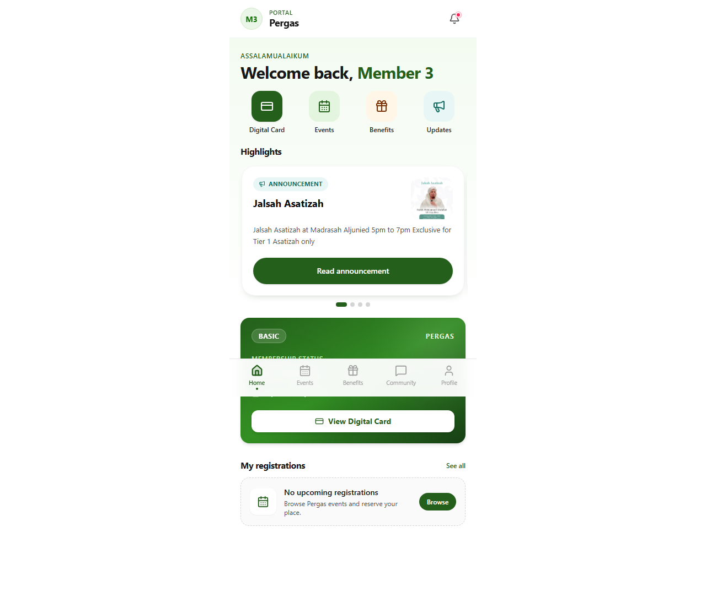

# TC-00: Test harness and accounts are ready

Status: **PASS**  ·  2026-10-29T13:16:11.945Z

| # | Step | Expected | Actual | Result |
|---|---|---|---|---|
| 1 | Anonymous call to member API | 401 | 401 | PASS |
| 2 | Log in as memberA (member3@uat.pergas.org) | logged in | logged in | PASS |
| 3 | Log in as memberB (member4@uat.pergas.org) | logged in | logged in | PASS |
| 4 | Log in as memberC (member5@uat.pergas.org) | logged in | logged in | PASS |
| 5 | Log in as admin (admin3@uat.pergas.org) | logged in | logged in | PASS |
| 6 | Logged-in member calls a member API | 200 | 200 | PASS |
| 7 | Logged-in member opens /member in the browser | stays on /member | /member | PASS |

## Screenshots

- 
