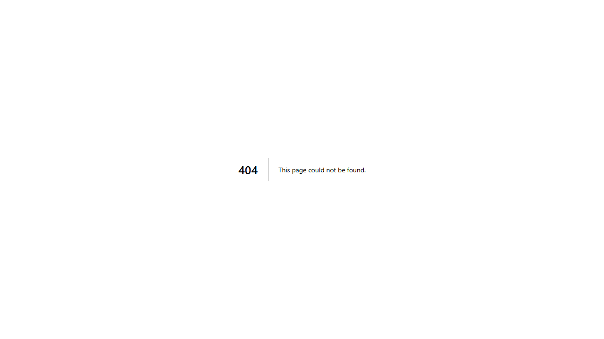
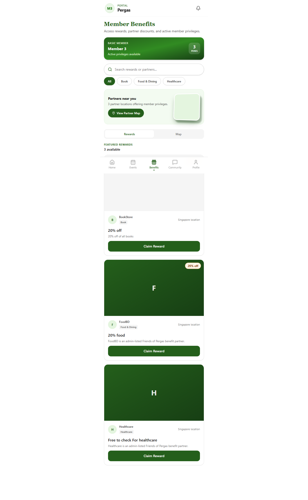

# TC-SFR-03: Membership-tier access control

Status: **PASS**  ·  2026-10-29T13:17:05.802Z

| # | Step | Expected | Actual | Result |
|---|---|---|---|---|
| 1 | 1 basic member registers for basic-tier event E1 | 200 | 200 | PASS |
| 2 | 2 RSVP to ordinary-only E2 refused | 403, no registration created | 403, 0 registration(s) | PASS |
| 3 | 3 RSVP link for E2 not revealed | 404, no redirect | 404 | PASS |
| 4 | 4 E2 detail page blocked | not-found screen; E2 not in page source | not-found screen; E2 not in source | PASS |
| 5 | 5 events list omits E2 | E2 not listed (E1 listed as control) | E2 not listed; E1 listed | PASS |
| 6 | 6 benefits page omits ordinary-only B1 | B1 not in page source | B1 not in source | PASS |
| 7 | 7 expired member refused even for allowed tier | 403, no registration | 403, 0 registration(s) | PASS |
| 8 | 8 post to ordinary-only group refused | 403 or 404, no thread created | 404, 0 thread(s) | PASS |

## Screenshots

- 
- 
