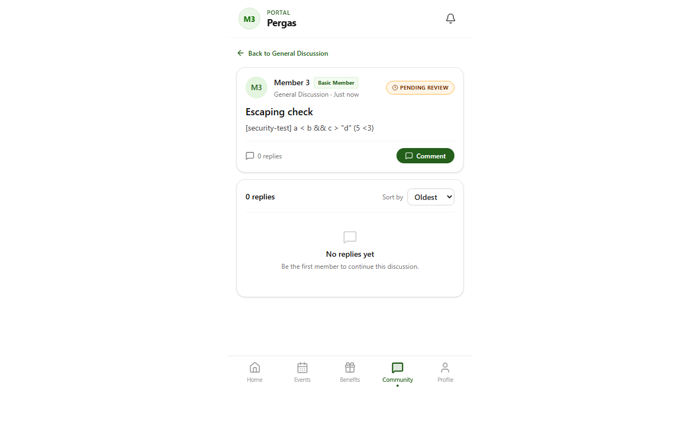

# TC-SFR-04: Server-side input validation and sanitisation

Status: **PASS**  ·  2026-10-29T13:17:19.656Z

| # | Step | Expected | Actual | Result |
|---|---|---|---|---|
| 1 | 1 malformed JSON: POST /api/admin/announcements | 400 with a message | 400 "Request body must be a JSON object" | PASS |
| 2 | 1 JSON array: POST /api/admin/announcements | 400 with a message | 400 "Request body must be a JSON object" | PASS |
| 3 | 1 empty body: POST /api/admin/announcements | 400 with a message | 400 "Invalid JSON payload" | PASS |
| 4 | 1 malformed JSON: PATCH /api/admin/announcements/00000000-0000-4000-8000-000000000000 | 400 with a message | 400 "Request body must be a JSON object" | PASS |
| 5 | 1 JSON array: PATCH /api/admin/announcements/00000000-0000-4000-8000-000000000000 | 400 with a message | 400 "Request body must be a JSON object" | PASS |
| 6 | 1 empty body: PATCH /api/admin/announcements/00000000-0000-4000-8000-000000000000 | 400 with a message | 400 "Invalid JSON payload" | PASS |
| 7 | 1 malformed JSON: POST /api/admin/batch-onboarding | 400 with a message | 400 "The uploaded information could not be read. Please upload the CSV again." | PASS |
| 8 | 1 JSON array: POST /api/admin/batch-onboarding | 400 with a message | 400 "The uploaded information could not be read. Please upload the CSV again." | PASS |
| 9 | 1 empty body: POST /api/admin/batch-onboarding | 400 with a message | 400 "The uploaded information could not be read. Please upload the CSV again." | PASS |
| 10 | 1 malformed JSON: PATCH /api/admin/comment-moderation | 400 with a message | 400 "Request body must be a JSON object" | PASS |
| 11 | 1 JSON array: PATCH /api/admin/comment-moderation | 400 with a message | 400 "Request body must be a JSON object" | PASS |
| 12 | 1 empty body: PATCH /api/admin/comment-moderation | 400 with a message | 400 "Invalid JSON payload" | PASS |
| 13 | 1 malformed JSON: PATCH /api/admin/discussion-groups | 400 with a message | 400 "Request body must be a JSON object" | PASS |
| 14 | 1 JSON array: PATCH /api/admin/discussion-groups | 400 with a message | 400 "Request body must be a JSON object" | PASS |
| 15 | 1 empty body: PATCH /api/admin/discussion-groups | 400 with a message | 400 "Invalid JSON payload" | PASS |
| 16 | 1 malformed JSON: POST /api/admin/engagement | 400 with a message | 400 "Request body must be a JSON object" | PASS |
| 17 | 1 JSON array: POST /api/admin/engagement | 400 with a message | 400 "Request body must be a JSON object" | PASS |
| 18 | 1 empty body: POST /api/admin/engagement | 400 with a message | 400 "Invalid JSON payload" | PASS |
| 19 | 1 malformed JSON: PATCH /api/admin/engagement/00000000-0000-4000-8000-000000000000 | 400 with a message | 400 "Request body must be a JSON object" | PASS |
| 20 | 1 JSON array: PATCH /api/admin/engagement/00000000-0000-4000-8000-000000000000 | 400 with a message | 400 "Request body must be a JSON object" | PASS |
| 21 | 1 empty body: PATCH /api/admin/engagement/00000000-0000-4000-8000-000000000000 | 400 with a message | 400 "Invalid JSON payload" | PASS |
| 22 | 1 malformed JSON: POST /api/admin/events | 400 with a message | 400 "Request body must be a JSON object" | PASS |
| 23 | 1 JSON array: POST /api/admin/events | 400 with a message | 400 "Request body must be a JSON object" | PASS |
| 24 | 1 empty body: POST /api/admin/events | 400 with a message | 400 "Invalid JSON payload" | PASS |
| 25 | 1 malformed JSON: PATCH /api/admin/events/00000000-0000-4000-8000-000000000000 | 400 with a message | 400 "Request body must be a JSON object" | PASS |
| 26 | 1 JSON array: PATCH /api/admin/events/00000000-0000-4000-8000-000000000000 | 400 with a message | 400 "Request body must be a JSON object" | PASS |
| 27 | 1 empty body: PATCH /api/admin/events/00000000-0000-4000-8000-000000000000 | 400 with a message | 400 "Invalid JSON payload" | PASS |
| 28 | 1 malformed JSON: PATCH /api/admin/members/00000000-0000-4000-8000-000000000000 | 400 with a message | 400 "Request body must be a JSON object" | PASS |
| 29 | 1 JSON array: PATCH /api/admin/members/00000000-0000-4000-8000-000000000000 | 400 with a message | 400 "Request body must be a JSON object" | PASS |
| 30 | 1 empty body: PATCH /api/admin/members/00000000-0000-4000-8000-000000000000 | 400 with a message | 400 "Invalid JSON payload" | PASS |
| 31 | 1 malformed JSON: POST /api/admin/payment-methods | 400 with a message | 400 "Request body must be a JSON object" | PASS |
| 32 | 1 JSON array: POST /api/admin/payment-methods | 400 with a message | 400 "Request body must be a JSON object" | PASS |
| 33 | 1 empty body: POST /api/admin/payment-methods | 400 with a message | 400 "Invalid JSON payload" | PASS |
| 34 | 1 malformed JSON: PATCH /api/admin/payment-methods/00000000-0000-4000-8000-000000000000 | 400 with a message | 400 "Request body must be a JSON object" | PASS |
| 35 | 1 JSON array: PATCH /api/admin/payment-methods/00000000-0000-4000-8000-000000000000 | 400 with a message | 400 "Request body must be a JSON object" | PASS |
| 36 | 1 empty body: PATCH /api/admin/payment-methods/00000000-0000-4000-8000-000000000000 | 400 with a message | 400 "Invalid JSON payload" | PASS |
| 37 | 1 malformed JSON: PATCH /api/admin/tier-requests | 400 with a message | 400 "Request body must be a JSON object" | PASS |
| 38 | 1 JSON array: PATCH /api/admin/tier-requests | 400 with a message | 400 "Request body must be a JSON object" | PASS |
| 39 | 1 empty body: PATCH /api/admin/tier-requests | 400 with a message | 400 "Invalid JSON payload" | PASS |
| 40 | 1 malformed JSON: POST /api/admin/upload | 400 with a message | 400 "Invalid multipart form data" | PASS |
| 41 | 1 JSON array: POST /api/admin/upload | 400 with a message | 400 "Invalid multipart form data" | PASS |
| 42 | 1 empty body: POST /api/admin/upload | 400 with a message | 400 "Invalid multipart form data" | PASS |
| 43 | 1 malformed JSON: POST /api/analytics/track | 400 with a message | 400 "Request body must be a JSON object" | PASS |
| 44 | 1 JSON array: POST /api/analytics/track | 400 with a message | 400 "Request body must be a JSON object" | PASS |
| 45 | 1 empty body: POST /api/analytics/track | 400 with a message | 400 "Invalid JSON payload" | PASS |
| 46 | 1 malformed JSON: POST /api/community/announcement-comments | 400 with a message | 400 "Request body must be a JSON object" | PASS |
| 47 | 1 JSON array: POST /api/community/announcement-comments | 400 with a message | 400 "Request body must be a JSON object" | PASS |
| 48 | 1 empty body: POST /api/community/announcement-comments | 400 with a message | 400 "Invalid JSON payload" | PASS |
| 49 | 1 malformed JSON: POST /api/community/announcement-poll | 400 with a message | 400 "Request body must be a JSON object" | PASS |
| 50 | 1 JSON array: POST /api/community/announcement-poll | 400 with a message | 400 "Request body must be a JSON object" | PASS |
| 51 | 1 empty body: POST /api/community/announcement-poll | 400 with a message | 400 "Invalid JSON payload" | PASS |
| 52 | 1 malformed JSON: POST /api/community/thread-comments | 400 with a message | 400 "Request body must be a JSON object" | PASS |
| 53 | 1 JSON array: POST /api/community/thread-comments | 400 with a message | 400 "Request body must be a JSON object" | PASS |
| 54 | 1 empty body: POST /api/community/thread-comments | 400 with a message | 400 "Invalid JSON payload" | PASS |
| 55 | 1 malformed JSON: POST /api/community/threads | 400 with a message | 400 "Request body must be a JSON object" | PASS |
| 56 | 1 JSON array: POST /api/community/threads | 400 with a message | 400 "Request body must be a JSON object" | PASS |
| 57 | 1 empty body: POST /api/community/threads | 400 with a message | 400 "Invalid JSON payload" | PASS |
| 58 | 1 malformed JSON: POST /api/events/rsvp | 400 with a message | 400 "Request body must be a JSON object" | PASS |
| 59 | 1 JSON array: POST /api/events/rsvp | 400 with a message | 400 "Request body must be a JSON object" | PASS |
| 60 | 1 empty body: POST /api/events/rsvp | 400 with a message | 400 "Invalid JSON payload" | PASS |
| 61 | 1 malformed JSON: PATCH /api/member/change-password | 400 with a message | 400 "Please complete all password fields and try again." | PASS |
| 62 | 1 JSON array: PATCH /api/member/change-password | 400 with a message | 400 "Please complete all password fields and try again." | PASS |
| 63 | 1 empty body: PATCH /api/member/change-password | 400 with a message | 400 "Please complete all password fields and try again." | PASS |
| 64 | 1 malformed JSON: POST /api/member/email-change/request | 400 with a message | 400 "Invalid request." | PASS |
| 65 | 1 JSON array: POST /api/member/email-change/request | 400 with a message | 400 "Invalid request." | PASS |
| 66 | 1 empty body: POST /api/member/email-change/request | 400 with a message | 400 "Invalid request." | PASS |
| 67 | 1 malformed JSON: POST /api/member/email-change/verify | 400 with a message | 400 "Invalid request." | PASS |
| 68 | 1 JSON array: POST /api/member/email-change/verify | 400 with a message | 400 "Invalid request." | PASS |
| 69 | 1 empty body: POST /api/member/email-change/verify | 400 with a message | 400 "Invalid request." | PASS |
| 70 | 1 malformed JSON: PATCH /api/member/notification-preferences | 400 with a message | 400 "Request body must be a JSON object" | PASS |
| 71 | 1 JSON array: PATCH /api/member/notification-preferences | 400 with a message | 400 "Request body must be a JSON object" | PASS |
| 72 | 1 empty body: PATCH /api/member/notification-preferences | 400 with a message | 400 "Invalid JSON payload" | PASS |
| 73 | 1 malformed JSON: PATCH /api/member/notifications | 400 with a message | 400 "Request body must be a JSON object" | PASS |
| 74 | 1 JSON array: PATCH /api/member/notifications | 400 with a message | 400 "Request body must be a JSON object" | PASS |
| 75 | 1 empty body: PATCH /api/member/notifications | 400 with a message | 400 "Invalid JSON payload" | PASS |
| 76 | 1 malformed JSON: PATCH /api/member/profile | 400 with a message | 400 "Request body must be a JSON object" | PASS |
| 77 | 1 JSON array: PATCH /api/member/profile | 400 with a message | 400 "Request body must be a JSON object" | PASS |
| 78 | 1 empty body: PATCH /api/member/profile | 400 with a message | 400 "Invalid JSON payload" | PASS |
| 79 | 1 malformed JSON: POST /api/member/tier-upgrade | 400 with a message | 400 "Request body must be a JSON object" | PASS |
| 80 | 1 JSON array: POST /api/member/tier-upgrade | 400 with a message | 400 "Request body must be a JSON object" | PASS |
| 81 | 1 empty body: POST /api/member/tier-upgrade | 400 with a message | 400 "Invalid JSON payload" | PASS |
| 82 | 1 malformed JSON: DELETE /api/events/rsvp | 400 with a message | 400 "Request body must be a JSON object" | PASS |
| 83 | 1 JSON array: DELETE /api/events/rsvp | 400 with a message | 400 "Request body must be a JSON object" | PASS |
| 84 | 1 empty body: DELETE /api/events/rsvp | 400 with a message | 400 "Invalid JSON payload" | PASS |
| 85 | 2 profile first_name is a number: PATCH /api/member/profile | 400 with a message | 400 "first_name must be a string" | PASS |
| 86 | 2 thread body is a number: POST /api/community/threads | 400 with a message | 400 "Post must be a string" | PASS |
| 87 | 2 comment threadId is an object: POST /api/community/thread-comments | 400 with a message | 400 "Thread ID must be a UUID" | PASS |
| 88 | 2 rsvp eventId is a number: POST /api/events/rsvp | 400 with a message | 400 "eventId is required" | PASS |
| 89 | 2 analytics eventType is a number: POST /api/analytics/track | 400 with a message | 400 "Event type must be one of: event_view, event_rsvp_click, benefit_view, announcement_view, " | PASS |
| 90 | 2 notification isRead is a string: PATCH /api/member/notifications | 400 with a message | 400 "Notification id and read state are required" | PASS |
| 91 | 2 event capacity is a string: POST /api/admin/events | 400 with a message | 400 "Capacity must be an integer between 0 and 2147483647" | PASS |
| 92 | 2 announcement poll_enabled is a string: POST /api/admin/announcements | 400 with a message | 400 "poll_enabled must be true or false" | PASS |
| 93 | 3 thread body 801 chars: POST /api/community/threads | 400 with a message | 400 "Post cannot exceed 800 characters" | PASS |
| 94 | 3 thread title 81 chars: POST /api/community/threads | 400 with a message | 400 "Title cannot exceed 80 characters" | PASS |
| 95 | 3 comment body 501 chars: POST /api/community/thread-comments | 400 with a message | 400 "Comment cannot exceed 500 characters" | PASS |
| 96 | 3 profile first_name 101 chars: PATCH /api/member/profile | 400 with a message | 400 "first_name cannot exceed 100 characters" | PASS |
| 97 | 3 tier-upgrade reason 1001 chars: POST /api/member/tier-upgrade | 400 with a message | 400 "Reason must be 1,000 characters or fewer" | PASS |
| 98 | 3 event title 201 chars: POST /api/admin/events | 400 with a message | 400 "title cannot exceed 200 characters" | PASS |
| 99 | 4 profile salutation 'king': PATCH /api/member/profile | 400 with a message | 400 "Invalid salutation" | PASS |
| 100 | 4 tier-upgrade tier 'platinum': POST /api/member/tier-upgrade | 400 with a message | 400 "Select a valid membership tier" | PASS |
| 101 | 4 notification action 'explode': PATCH /api/member/notifications | 400 with a message | 400 "Invalid notification action" | PASS |
| 102 | 4 poll response 'perhaps': POST /api/community/announcement-poll | 400 with a message | 400 "Polls are only available on official announcements" | PASS |
| 103 | 4 analytics category 'secret': POST /api/analytics/track | 400 with a message | 400 "Category must be one of: event, benefit, announcement, system" | PASS |
| 104 | 4 event status 'live': POST /api/admin/events | 400 with a message | 400 "Status must be one of: draft, published, archived" | PASS |
| 105 | 4 tier-request action 'escalate': PATCH /api/admin/tier-requests | 400 with a message | 400 "Request id and a valid action are required" | PASS |
| 106 | 4 member list tier 'gold': GET /api/admin/members?tier=gold | 400 with a message | 400 "Tier must be one of: basic, student, associate, ordinary" | PASS |
| 107 | 5 thread with : POST /api/community/threads | 400 with a message | 400 "Post must be plain text without HTML markup" | PASS |
| 108 | 5 thread comment with : POST /api/community/thread-comments | 400 with a message | 400 "Comment must be plain text without HTML markup" | PASS |
| 109 | 5 announcement comment with : POST /api/community/announcement-comments | 400 with a message | 400 "Comment must be plain text without HTML markup" | PASS |
| 110 | 6 thread with : POST /api/community/threads | 400 with a message | 400 "Post must be plain text without HTML markup" | PASS |
| 111 | 6 thread comment with : POST /api/community/thread-comments | 400 with a message | 400 "Comment must be plain text without HTML markup" | PASS |
| 112 | 6 announcement comment with : POST /api/community/announcement-comments | 400 with a message | 400 "Comment must be plain text without HTML markup" | PASS |
| 113 | 6 thread with <svg/onload=alert(1)>: POST /api/community/threads | 400 with a message | 400 "Post must be plain text without HTML markup" | PASS |
| 114 | 6 thread comment with <svg/onload=alert(1)>: POST /api/community/thread-comments | 400 with a message | 400 "Comment must be plain text without HTML markup" | PASS |
| 115 | 6 announcement comment with <svg/onload=alert(1)>: POST /api/community/announcement-comments | 400 with a message | 400 "Comment must be plain text without HTML markup" | PASS |
| 116 | 6 thread with <!--x-->: POST /api/community/threads | 400 with a message | 400 "Post must be plain text without HTML markup" | PASS |
| 117 | 6 thread comment with <!--x-->: POST /api/community/thread-comments | 400 with a message | 400 "Comment must be plain text without HTML markup" | PASS |
| 118 | 6 announcement comment with <!--x-->: POST /api/community/announcement-comments | 400 with a message | 400 "Comment must be plain text without HTML markup" | PASS |
| 119 | 5-6 no markup payload stored | 0 rows | 0 row(s) | PASS |
| 120 | 7 plain text with < > " accepted | 200 | 200 | PASS |
| 121 | 7 text shown literally, no script ran | text visible as typed; 0 dialogs | visible as typed; 0 dialog(s) | PASS |
| 122 | 8 event RSVP URL javascript:aler: POST /api/admin/events | 400 with a message | 400 "external_rsvp_url must be an HTTP or HTTPS URL" | PASS |
| 123 | 8 event RSVP URL data:text/html,: POST /api/admin/events | 400 with a message | 400 "external_rsvp_url must be an HTTP or HTTPS URL" | PASS |
| 124 | 9 app/api/admin/analytics/route.ts | reads input and validates it | validates | PASS |
| 125 | 9 app/api/admin/announcements/route.ts | reads input and validates it | validates | PASS |
| 126 | 9 app/api/admin/announcements/[id]/route.ts | reads input and validates it | validates | PASS |
| 127 | 9 app/api/admin/batch-onboarding/route.ts | reads input and validates it | validates | PASS |
| 128 | 9 app/api/admin/comment-moderation/route.ts | reads input and validates it | validates | PASS |
| 129 | 9 app/api/admin/discussion-groups/route.ts | reads input and validates it | validates | PASS |
| 130 | 9 app/api/admin/engagement/route.ts | reads input and validates it | validates | PASS |
| 131 | 9 app/api/admin/engagement/[id]/route.ts | reads input and validates it | validates | PASS |
| 132 | 9 app/api/admin/events/route.ts | reads input and validates it | validates | PASS |
| 133 | 9 app/api/admin/events/[id]/registrations/route.ts | reads input and validates it | validates | PASS |
| 134 | 9 app/api/admin/events/[id]/route.ts | reads input and validates it | validates | PASS |
| 135 | 9 app/api/admin/members/route.ts | reads input and validates it | validates | PASS |
| 136 | 9 app/api/admin/members/[id]/route.ts | reads input and validates it | validates | PASS |
| 137 | 9 app/api/admin/payment-methods/route.ts | reads input and validates it | validates | PASS |
| 138 | 9 app/api/admin/payment-methods/[id]/route.ts | reads input and validates it | validates | PASS |
| 139 | 9 app/api/admin/team/route.ts | reads input and validates it | validates | PASS |
| 140 | 9 app/api/admin/tier-requests/route.ts | reads input and validates it | validates | PASS |
| 141 | 9 app/api/admin/upload/route.ts | reads input and validates it | validates | PASS |
| 142 | 9 app/api/analytics/track/route.ts | reads input and validates it | validates | PASS |
| 143 | 9 app/api/auth/login/route.ts | reads input and validates it | validates | PASS |
| 144 | 9 app/api/auth/register/route.ts | reads input and validates it | validates | PASS |
| 145 | 9 app/api/community/announcement-comments/route.ts | reads input and validates it | validates | PASS |
| 146 | 9 app/api/community/announcement-poll/route.ts | reads input and validates it | validates | PASS |
| 147 | 9 app/api/community/thread-comments/route.ts | reads input and validates it | validates | PASS |
| 148 | 9 app/api/community/threads/route.ts | reads input and validates it | validates | PASS |
| 149 | 9 app/api/events/rsvp/route.ts | reads input and validates it | validates | PASS |
| 150 | 9 app/api/member/change-password/route.ts | reads input and validates it | validates | PASS |
| 151 | 9 app/api/member/notification-preferences/route.ts | reads input and validates it | validates | PASS |
| 152 | 9 app/api/member/notifications/route.ts | reads input and validates it | validates | PASS |
| 153 | 9 app/api/member/profile/route.ts | reads input and validates it | validates | PASS |
| 154 | 9 app/api/member/tier-upgrade/route.ts | reads input and validates it | validates | PASS |
| 155 | 9 app/api/verify/member/route.ts | reads input and validates it | validates | PASS |

## Screenshots

- 
