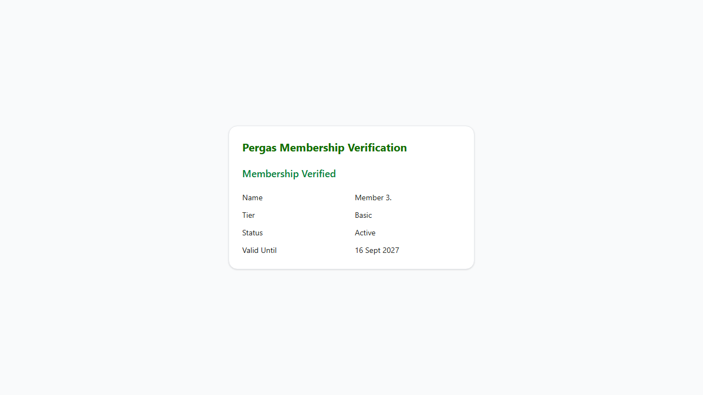
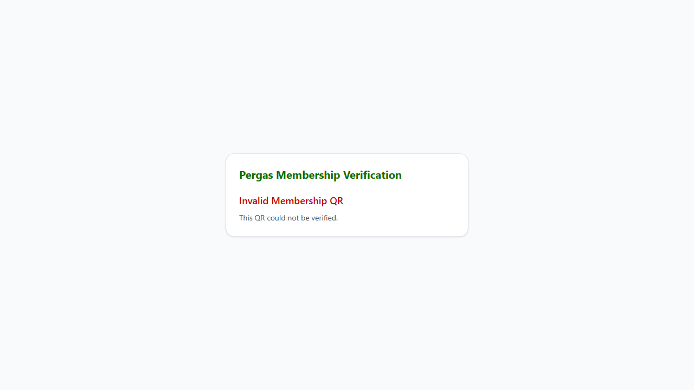

# TC-SFR-07: Secure digital membership verification

Status: **PASS**  ·  2026-10-29T13:17:55.630Z

| # | Step | Expected | Actual | Result |
|---|---|---|---|---|
| 1 | 1 token is signed HS256 | alg = HS256 | alg = HS256 | PASS |
| 2 | 1 payload holds only the needed fields | exp, iat, memberId, purpose | exp, iat, memberId, purpose | PASS |
| 3 | 1 token lifetime | 300 seconds | 300 seconds | PASS |
| 4 | 2 genuine token verifies | valid: true | valid: true | PASS |
| 5 | 2 response holds only display fields | displayName, expiryDate, membershipStatus, membershipTier | displayName, expiryDate, membershipStatus, membershipTier | PASS |
| 6 | 2 display name is first name + last initial | Member 3. | Member 3. | PASS |
| 7 | 3 payload changed to memberB's id | valid: false, code: invalid | valid: false, code: invalid | PASS |
| 8 | 4 signature altered | valid: false, code: invalid | valid: false, code: invalid | PASS |
| 9 | 5 expired QR | valid: false, code: expired | valid: false, code: expired | PASS |
| 10 | 6 signed with a different secret | valid: false, code: invalid | valid: false, code: invalid | PASS |
| 11 | 6 wrong purpose | valid: false, code: invalid | valid: false, code: invalid | PASS |
| 12 | 6 member's session token used as a QR | valid: false, code: invalid | valid: false, code: invalid | PASS |
| 13 | 7 qr-token response headers | Cache-Control: no-store; Referrer-Policy: no-referrer | Cache-Control: private, no-store, max-age=0; Referrer-Policy: no-referrer | PASS |
| 14 | 7 verify response headers | Cache-Control: no-store; Referrer-Policy: no-referrer | Cache-Control: private, no-store, max-age=0; Referrer-Policy: no-referrer | PASS |
| 15 | 8 verify page shows the member card for a genuine QR | shows "Member 3." | member card shown | PASS |
| 16 | 8 verify page rejects a tampered QR | shows "Invalid Membership QR" | rejected | PASS |

## Screenshots

- 
- 
