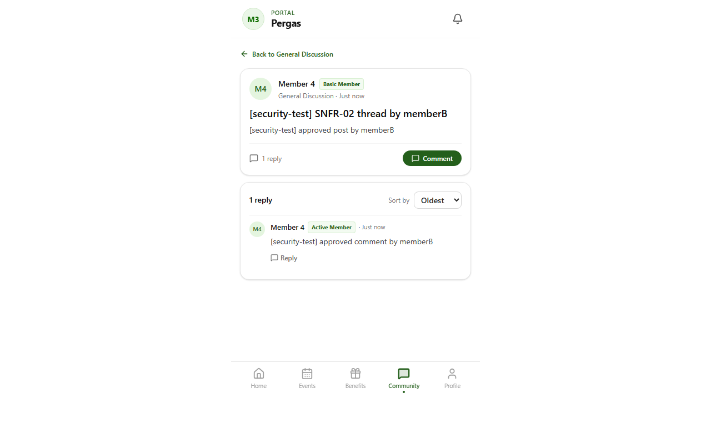

# TC-SNFR-02: Personal data minimisation

Status: **PASS**  ·  2026-10-29T13:18:17.732Z

| # | Step | Expected | Actual | Result |
|---|---|---|---|---|
| 1 | 1 /api/member/notifications returns only needed fields | unreadCount | only allowed fields (1) | PASS |
| 2 | 1 /api/member/notifications has no personal identifier fields | none of password_hash, passwordHash, email, phone, user_id, userId | none | PASS |
| 3 | 1 /api/member/notification-preferences returns only needed fields | preferences, preferences.benefit, preferences.announcement, preferences.event, preferences.email | only allowed fields (5) | PASS |
| 4 | 1 /api/member/notification-preferences has no personal identifier fields | none of password_hash, passwordHash, email, phone, user_id, userId | none | PASS |
| 5 | 1 /api/member/tier-upgrade returns only needed fields | currentTier, availableTiers, availableTiers[].value, availableTiers[].label, requests, requests[].id, requests[].current_tier, requests[].requested_tier, requests[].reason, requests[].status, requests[].admin_note, requests[].reviewed_at, requests[].created_at | only allowed fields (5) | PASS |
| 6 | 1 /api/member/tier-upgrade has no personal identifier fields | none of password_hash, passwordHash, email, phone, user_id, userId | none | PASS |
| 7 | 1 /api/member/qr-token returns only needed fields | verificationUrl, expiresIn | only allowed fields (2) | PASS |
| 8 | 1 /api/member/qr-token has no personal identifier fields | none of password_hash, passwordHash, email, phone, user_id, userId | none | PASS |
| 9 | 2 QR payload fields | exp, iat, memberId, purpose | exp, iat, memberId, purpose | PASS |
| 10 | 2 verify response fields | member, member.displayName, member.expiryDate, member.membershipStatus, member.membershipTier, valid | member, member.displayName, member.expiryDate, member.membershipStatus, member.membershipTier, valid | PASS |
| 11 | 3 /member (as memberA) | no other member's email, phone, id or password hash | none found | PASS |
| 12 | 3 /member/community (as memberA) | no other member's email, phone, id or password hash | none found | PASS |
| 13 | 3 /member/community/ea6c2f10-68b3-46b3-b699-cc11b32f090a (as memberA) | no other member's email, phone, id or password hash | none found | PASS |
| 14 | 3 /member/events (as memberA) | no other member's email, phone, id or password hash | none found | PASS |
| 15 | 3 /member/benefit (as memberA) | no other member's email, phone, id or password hash | none found | PASS |
| 16 | 4 login: unknown email and wrong password look the same | identical status and message | both 401 {"error":"Invalid credentials"} | PASS |
| 17 | 4 email change with wrong password does not confirm an existing address | 401 (not 409) | 401 | PASS |
| 18 | 5 /api/admin/members has no password hash | no password_hash | 200, none | PASS |
| 19 | 5 /api/admin/members/f7081c04-31f7-4eb8-9d88-425f0d89dfb5 has no password hash | no password_hash | 200, none | PASS |
| 20 | 5 /api/admin/team has no password hash | no password_hash | 200, none | PASS |
| 21 | 5 /api/admin/dashboard has no password hash | no password_hash | 200, none | PASS |
| 22 | 6 no select("*") in app or lib | 0 files | 0 files | PASS |
| 23 | 6 password_hash only in authentication code | app/api/auth/login/route.ts, app/api/auth/register/route.ts, app/api/member/change-password/route.ts, app/api/admin/batch-onboarding/route.ts, lib/emailChange.ts, lib/emailChangeServer.ts | app/api/admin/batch-onboarding/route.ts, app/api/auth/login/route.ts, app/api/auth/register/route.ts, app/api/member/change-password/route.ts, lib/emailChange.ts, lib/emailChangeServer.ts | PASS |

## Screenshots

- 
